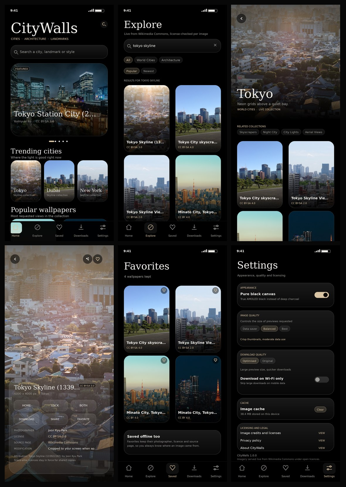
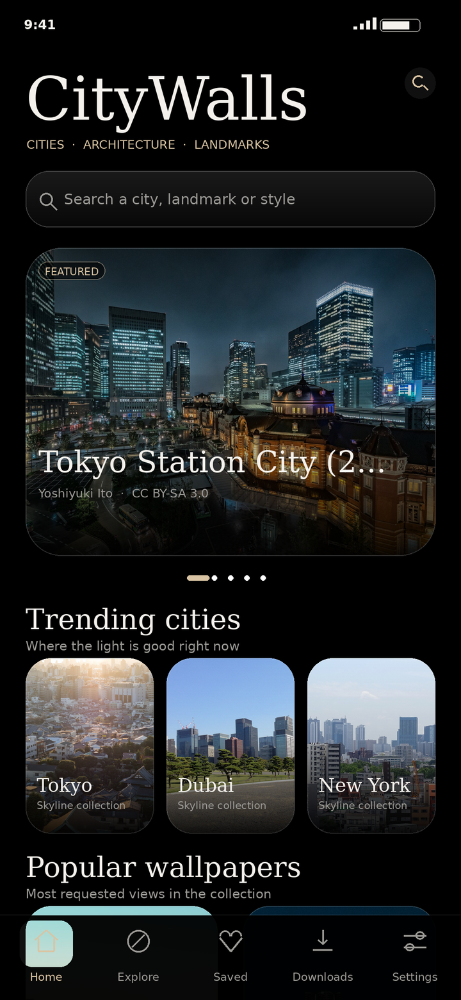
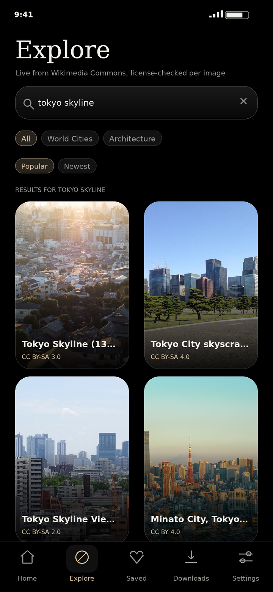
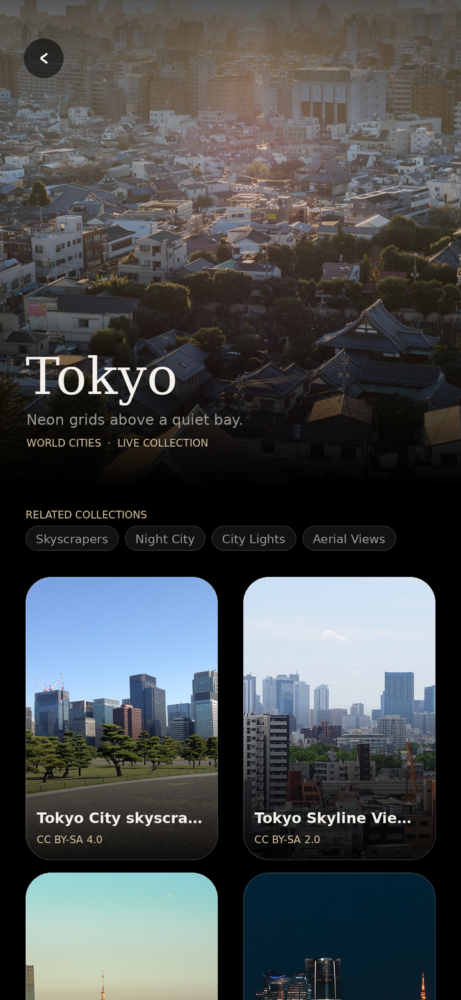
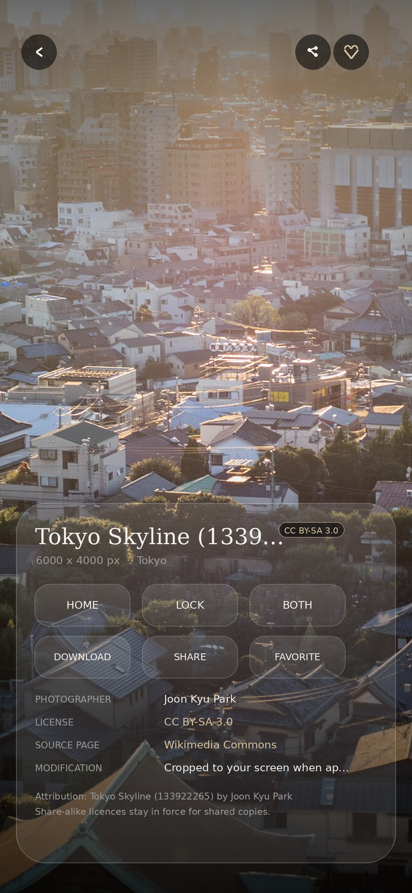
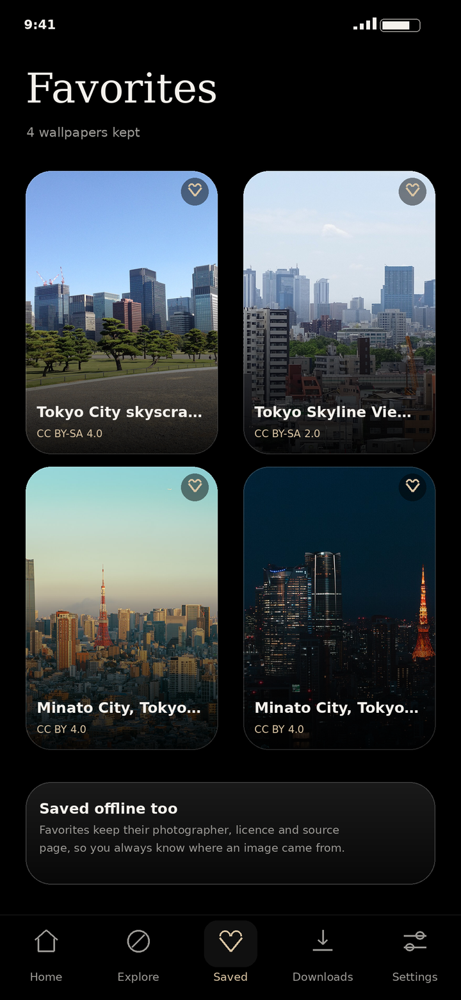
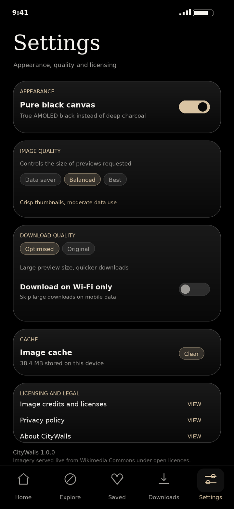

# CityWalls

**[github.com/technicalnihilist-lgtm/citywalls](https://github.com/technicalnihilist-lgtm/citywalls)** · Android wallpaper app for city photography

> **[Download the signed APK](https://github.com/technicalnihilist-lgtm/citywalls/releases/download/v1.0.3/CityWalls-1.0.3-release.apk)** · 8.0 MB · versionCode 4 · `adb install -r CityWalls-1.0.3-release.apk`



A premium Android wallpaper app for city photography — twenty world cities, four
architecture collections, twelve street-photography moods and ten landmarks.

Kotlin · Jetpack Compose · Material 3 · MVVM + Repository · Room · Coil · Retrofit ·
WallpaperManager. Every wallpaper is fetched **live** from the Wikimedia Commons API
and must pass a license check before it is allowed on screen. The app ships no
photographs of its own: no bundled artwork, no placeholder images, no scraped
wallpaper-site content.

| | |
| --- | --- |
| Package | `com.citywalls.app` |
| Version | 1.0.3 (versionCode 4) |
| Min / target SDK | 24 / 35 |
| APK size | 8.0 MB (release, signed) |
| Build status | `assembleRelease` succeeds, APK signed and verified |

---

## 1. Install the APK

`CityWalls-1.0.1-release.apk` (8.0 MB, versionCode 2) is signed with the
CityWalls release key — `CN=CityWalls, OU=Mobile, O=CityWalls, L=Mumbai, C=IN`,
SHA-256 `9cdd64c3ff767d9bf9cbc360b22ed2f441e626450cd6e94dd1ac94eaf5a84711`.
The APK lives on the [v1.0.2 release page](https://github.com/technicalnihilist-lgtm/citywalls/releases/tag/v1.0.3)
rather than in the tree (8 MB binary), or build it with the command in section 2.
SHA-256: `77d21decae399a75157338df27da436647640ebf2fa6a2be101f2f418ab12532`.

```
adb install -r dist/CityWalls-1.0.1-release.apk
```

Or copy the file to the phone and open it, allowing installs from unknown sources.
Android 7.0 (API 24) or newer. The app needs a network connection because all
imagery is live.

## 2. Build from source

Verified toolchain: **JDK 17, Gradle 8.9, AGP 8.7.2, Kotlin 2.0.20, compileSdk 35,
build-tools 35.0.0**.

1. `File → Open` this folder in Android Studio (Koala or newer) and let it sync.
2. Run the `app` configuration on a device or emulator.
3. Or from the CLI, after `gradle wrapper` once to materialise the wrapper JAR:

```
./gradlew :app:assembleDebug          # → app/build/outputs/apk/debug/app-debug.apk
./gradlew :app:testDebugUnitTest      # license gate unit tests
```

Release builds read their signing credentials from Gradle properties, so no key
material is committed:

```
./gradlew :app:assembleRelease \
  -Pcitywalls.storeFile=keystore/citywalls-release.jks \
  -Pcitywalls.storePassword=******** \
  -Pcitywalls.keyAlias=citywalls \
  -Pcitywalls.keyPassword=********
```

`keystore/` is gitignored. **Keep `citywalls-release.jks` and its password safe** —
without them you cannot ship an update that Android will accept over the installed
app. The APK in `dist/` was produced by exactly this command.

## 3. Screenshots

| Home | Explore | City detail |
| --- | --- | --- |
|  |  |  |

| Wallpaper detail | Favorites | Settings |
| --- | --- | --- |
|  |  |  |

These previews are rendered at 1080 × 2340 from the app's own design tokens
(colours, type scale, spacing, component shapes) using **live, license-checked
Wikimedia Commons photographs and their real metadata** — the same API calls and
the same license filter the app runs. They are design renders, not device captures:
this project was built in a headless environment without an emulator, so no
screenshot could be taken from a running device.

## 4. Before you publish — checklist

| Item | Where |
| --- | --- |
| Real contact address in the Wikimedia User-Agent | `di/AppContainer.kt` → `USER_AGENT` |
| Your application id / package | `app/build.gradle.kts` → `applicationId` |
| Release signing config | `app/build.gradle.kts` → `buildTypes.release` |
| Privacy policy URL for the Play listing | host the text in `ui/legal/PrivacyPolicyScreen.kt` |

Wikimedia's API policy expects a descriptive `User-Agent` with a way to contact you.
Leaving the placeholder address in a published build is not acceptable.

## 5. Screens

| Screen | What it does |
| --- | --- |
| **Home** | Brand block, swipeable featured carousel, trending cities, popular wallpapers, recently added, category chips, credits note, refresh |
| **Explore** | Debounced search over the whole collection, group chips (All / Cities / Architecture / Photography / Landmarks), sort chips (Popular / Newest), paginated 2-column grid, browse-by-category grid when the query is empty |
| **City detail** | Cinematic header image, city blurb, related collections, paginated wallpaper grid with infinite scroll |
| **Wallpaper detail** | Full-bleed preview, set Home / Lock / Both, download, favorite, share, resolution, photographer, license (tap → deed), source page (tap → Commons), attribution and modification note |
| **Favorites** | Room-backed grid, tap to open, heart to remove |
| **Downloads** | Local files with size, apply-to-both offline, open detail, delete file |
| **Settings** | Pure-black AMOLED toggle, image quality, download quality, Wi-Fi-only switch, cache size + clear, credits / privacy / about |
| **Credits / Privacy / About** | Licensing policy, license deeds, attribution rules, what the app refuses to do |

## 6. Design language

- Pure black (`#000000`) or deep charcoal (`#0A0A0B`) canvas, user-switchable.
- Glassmorphism cards: translucent white gradient fill + hairline light border.
- Champagne gold accents (`#D9C4A3`, `#B99A63`), warm grey secondary text.
- Editorial serif headings, neutral sans UI labels, uppercase micro-labels.
- Rounded 14–30 dp corners, 12–20 dp gutters, dot page indicators, no neon.
- Hand-drawn vector icon set (`res/drawable/ic_*.xml`) instead of the 30 MB
  `material-icons-extended` library — that single change keeps the APK at ~12 MB
  and cuts dexing time dramatically.
- Cross-faded image loads (280 ms), 220 ms navigation fades.

## 7. Architecture

```
app/src/main/java/com/citywalls/app/
├── CityWallsApplication.kt        Coil ImageLoader + AppContainer bootstrap
├── MainActivity.kt                edge-to-edge Compose host
├── di/AppContainer.kt             OkHttp, Retrofit, Room, repos, downloader, applier
├── domain/                        Wallpaper, WallpaperPage, Catalog, enums
├── data/
│   ├── remote/                    CommonsApi, params interceptor, DTOs,
│   │                              CommonsMapper, CommonsUrls, LicensePolicy
│   ├── local/                     Room database, entities, DAOs, mappers
│   ├── prefs/SettingsRepository   DataStore settings
│   └── repository/                WallpaperRepository (single source of truth)
├── util/                          BitmapUtils, WallpaperSetter, WallpaperApplier,
│                                  WallpaperDownloader, ShareUtils, HtmlText
└── ui/
    ├── common/                    AppVmFactory, LocalAppContainer, WallpaperPaginator
    ├── components/                Glass, cards, grids, state views, back header
    ├── theme/                     Colour, type, Material 3 scheme
    ├── navigation/                Routes, NavHost, bottom bar
    └── home|explore|city|detail|favorites|downloads|settings|legal/
```

MVVM + repository, manual dependency injection (no Hilt, no kapt). Each screen has
its own ViewModel with `StateFlow` state; `WallpaperPaginator` owns offset
pagination, duplicate suppression and retry.

## 8. How the images work (online only)

Base URL: `https://commons.wikimedia.org/w/api.php`

`CommonsParamsInterceptor` adds the shared parameters to every call:

```
action=query & format=json & formatversion=2
prop=imageinfo|categories & iiprop=url|size|mime|extmetadata
cllimit=30 & clshow=!hidden
```

Each search supplies `gsrsearch`, `gsrnamespace=6`, `gsrlimit=24`, `gsroffset`,
`gsrsort` and `iiurlwidth` (driven by the image-quality setting). Three URL sizes
come out of one request:

| Use | Source |
| --- | --- |
| Grid thumbnail (~480 px) | derived from the preview URL by `CommonsUrls.scaled` |
| Detail preview (1024–2400 px) | `imageinfo.thumburl` at `iiurlwidth` |
| Apply / download | `imageinfo.url` (original file) |

Paging uses the API's `continue.gsroffset`. Results are cached in memory with a
15-minute TTL, plus OkHttp's 40 MB HTTP cache and Coil's 300 MB disk cache, so
re-opening a shelf is instant while new content still appears as Commons changes.

Loading, error, empty and loading-more states are handled everywhere; every error
surface has a retry action.

## 9. Licensing (the important part)

`data/remote/LicensePolicy.kt` is the gate. An image is displayed **only** when its
Commons metadata positively identifies one of:

- Public domain (`pd`, `public domain`, PD templates)
- CC0 / CC Zero
- CC BY (any version)
- CC BY-SA (any version)

Everything else is dropped:

- Non-commercial (`-nc`, "noncommercial") — unusable in a commercial app
- No-derivatives (`-nd`, "no derivative") — we resize and crop
- Fair use, non-free, "all rights reserved", copyrighted stock
- Any file carrying an `extmetadata.Restrictions` value
- Files in maintenance categories: freedom-of-panorama warnings, deletion requests,
  missing permission, possibly unfree, copyright violations
- Unrecognised or missing license metadata
- Non-photographic formats (SVG/TIFF/GIF) and files below the quality floor

No image is ever assumed free because it sits on Commons. When a shelf has no
license-safe result, the app shows an empty state that explains why instead of
showing an unlicensed photograph.

Per wallpaper the app stores and displays: title, photographer/creator, original
source page, license name, license URL, required attribution, and the modification
note ("resized thumbnail; cropped to your screen when applied").

`app/src/test/.../LicensePolicyTest.kt` covers the accept and reject paths.

## 10. Wallpaper setting and downloads

- `WallpaperSetter` calls `WallpaperManager.setBitmap` with `FLAG_SYSTEM`,
  `FLAG_LOCK` or both — so "Home", "Lock" and "Both" all really work.
- `BitmapUtils` decodes with `inSampleSize` (never loads a 6000 px original into
  memory) and centre-crops to the exact screen aspect before setting.
- Downloads land in app-specific external storage (`Pictures/CityWalls`) — no
  permission needed — and are additionally exported to the system gallery through
  MediaStore on Android 10+. `WRITE_EXTERNAL_STORAGE` is declared with
  `maxSdkVersion="28"` and requested only at the moment of a download on Android 9
  or older.
- Re-downloading the same wallpaper reuses the existing file, so nothing duplicates.
- Downloads are offline-capable: the detail screen prefers the local file when
  present, and the Downloads screen can apply straight from disk.

## 11. Performance notes

- Thumbnails first; originals only on apply/download.
- Coil memory cache 25% of RAM, 300 MB disk cache, crossfade on.
- `LazyVerticalGrid` / `LazyColumn` everywhere; pagination triggers four items
  before the end.
- Repository de-duplicates by source URL within a page and by page id across pages.
- No background services, no polling, no WorkManager. The only long-lived objects
  are the OkHttp client and Room database.

## 12. Known limits

- **Online required for browsing.** By design there is no bundled imagery; with no
  connection you get error states with retry, plus anything you downloaded earlier.
- Commons search is full-text, so results are editorial rather than curated. Change
  the queries in `domain/Catalog.kt` to tune a shelf.
- The license gate is conservative: it drops images whose metadata is ambiguous, so
  some usable files never appear. That trade is intentional.
- `gradle/wrapper/gradle-wrapper.jar` is intentionally absent; Android Studio
  regenerates it, or run `gradle wrapper`.
- The shipped APK is signed with the bundled `keystore/citywalls-release.jks`
  (password in `keystore/README.txt`). Replace it with your own upload key before
  publishing to Play, and never commit the keystore.

## 13. Changelog

**1.0.3** (versionCode 4)
- Removed the "Download on Wi-Fi only" switch: downloads always use the available
  connection, mobile data included. No part of the app requires Wi-Fi.

**1.0.2** (versionCode 3)
- Fixed: "Download on Wi-Fi only" was persisted but never enforced. Downloads now
  check the active connection and refuse to run over mobile data.

**1.0.1** (versionCode 2)
- First signed release build, custom vector icon set, screenshot set, docs.

**1.0.0** (versionCode 1)
- Initial Compose app: catalog, live Commons feed, license gate, favorites,
  downloads, wallpaper manager integration.

## 14. Attribution

Photography: Wikimedia Commons contributors, under the licenses shown on each
wallpaper's detail screen. CityWalls is not affiliated with the Wikimedia
Foundation.
