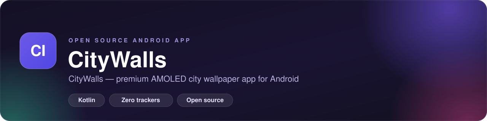
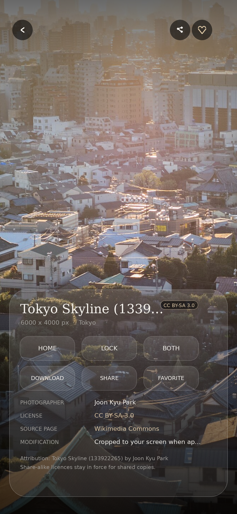
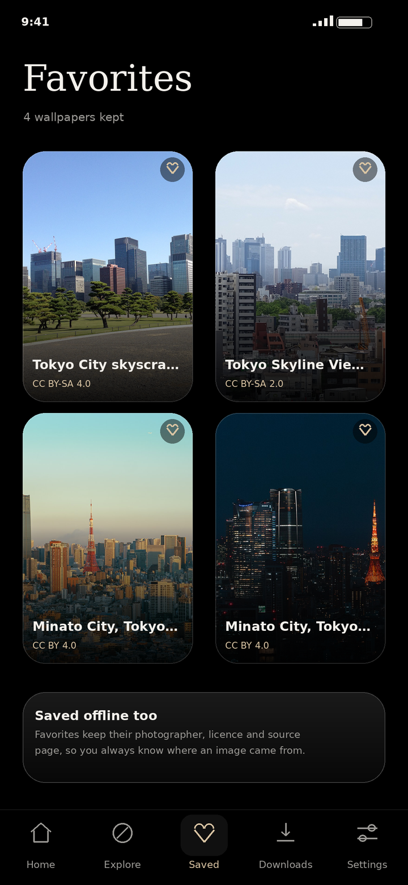
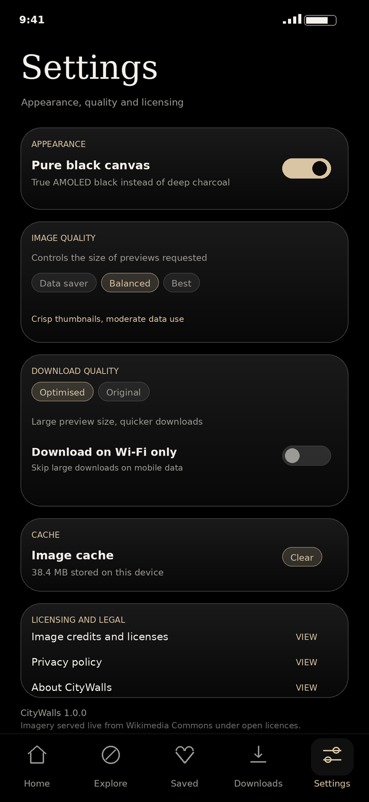

<div align="center">



<a href="https://github.com/technicalnihilist-lgtm/citywalls/stargazers"></a>&nbsp;<a href="https://github.com/technicalnihilist-lgtm/citywalls/network/members"></a>

<a href="https://github.com/technicalnihilist-lgtm/citywalls/releases/latest"></a>

<b>Support the work</b>

  

<sub>Donations aren't live yet — Paytm, UPI, PayPal and Buy&nbsp;Me&nbsp;a&nbsp;Coffee all show <b>coming soon</b>. Until then, a ⭐ star is the best support.</sub>

<a href="https://github.com/technicalnihilist-lgtm/citywalls/releases/latest"></a>  <a href="https://github.com/technicalnihilist-lgtm/citywalls/releases"></a>

</div>

---

## 1. Install the APK

`CityWalls-1.0.1-release.apk` (8.0 MB, versionCode 2) is signed with the
CityWalls release key — `CN=CityWalls, OU=Mobile, O=CityWalls, L=Mumbai, C=IN`,
SHA-256 `9cdd64c3ff767d9bf9cbc360b22ed2f441e626450cd6e94dd1ac94eaf5a84711`.
The APK lives on the [v1.0.2 release page](https://github.com/technicalnihilist-lgtm/citywalls/releases/tag/v1.0.3)
rather than in the tree (8 MB binary), or build it with the command in section 2.
SHA-256: `77d21decae399a75157338df27da436647640ebf2fa6a2be101f2f418ab12532`.

```
adb install -r dist/CityWalls-1.0.1-release.apk
```

Or copy the file to the phone and open it, allowing installs from unknown sources.
Android 7.0 (API 24) or newer. The app needs a network connection because all
imagery is live.

## 2. Build from source

Verified toolchain: **JDK 17, Gradle 8.9, AGP 8.7.2, Kotlin 2.0.20, compileSdk 35,
build-tools 35.0.0**.

1. `File → Open` this folder in Android Studio (Koala or newer) and let it sync.
2. Run the `app` configuration on a device or emulator.
3. Or from the CLI, after `gradle wrapper` once to materialise the wrapper JAR:

```
./gradlew :app:assembleDebug          # → app/build/outputs/apk/debug/app-debug.apk
./gradlew :app:testDebugUnitTest      # license gate unit tests
```

Release builds read their signing credentials from Gradle properties, so no key
material is committed:

```
./gradlew :app:assembleRelease \
  -Pcitywalls.storeFile=keystore/citywalls-release.jks \
  -Pcitywalls.storePassword=******** \
  -Pcitywalls.keyAlias=citywalls \
  -Pcitywalls.keyPassword=********
```

`keystore/` is gitignored. **Keep `citywalls-release.jks` and its password safe** —
without them you cannot ship an update that Android will accept over the installed
app. The APK in `dist/` was produced by exactly this command.

## 3. Screenshots

| Home | Explore | City detail |
| --- | --- | --- |
|  |  |  |

| Wallpaper detail | Favorites | Settings |
| --- | --- | --- |
|  |  |  |

These previews are rendered at 1080 × 2340 from the app's own design tokens
(colours, type scale, spacing, component shapes) using **live, license-checked
Wikimedia Commons photographs and their real metadata** — the same API calls and
the same license filter the app runs. They are design renders, not device captures:
this project was built in a headless environment without an emulator, so no
screenshot could be taken from a running device.

## 4. Before you publish — checklist

| Item | Where |
| --- | --- |
| Real contact address in the Wikimedia User-Agent | `di/AppContainer.kt` → `USER_AGENT` |
| Your application id / package | `app/build.gradle.kts` → `applicationId` |
| Release signing config | `app/build.gradle.kts` → `buildTypes.release` |
| Privacy policy URL for the Play listing | host the text in `ui/legal/PrivacyPolicyScreen.kt` |

Wikimedia's API policy expects a descriptive `User-Agent` with a way to contact you.
Leaving the placeholder address in a published build is not acceptable.

## 5. Screens

| Screen | What it does |
| --- | --- |
| **Home** | Brand block, swipeable featured carousel, trending cities, popular wallpapers, recently added, category chips, credits note, refresh |
| **Explore** | Debounced search over the whole collection, group chips (All / Cities / Architecture / Photography / Landmarks), sort chips (Popular / Newest), paginated 2-column grid, browse-by-category grid when the query is empty |
| **City detail** | Cinematic header image, city blurb, related collections, paginated wallpaper grid with infinite scroll |
| **Wallpaper detail** | Full-bleed preview, set Home / Lock / Both, download, favorite, share, resolution, photographer, license (tap → deed), source page (tap → Commons), attribution and modification note |
| **Favorites** | Room-backed grid, tap to open, heart to remove |
| **Downloads** | Local files with size, apply-to-both offline, open detail, delete file |
| **Settings** | Pure-black AMOLED toggle, image quality, download quality, Wi-Fi-only switch, cache size + clear, credits / privacy / about |
| **Credits / Privacy / About** | Licensing policy, license deeds, attribution rules, what the app refuses to do |

## 6. Design language

- Pure black (`#000000`) or deep charcoal (`#0A0A0B`) canvas, user-switchable.
- Glassmorphism cards: translucent white gradient fill + hairline light border.
- Champagne gold accents (`#D9C4A3`, `#B99A63`), warm grey secondary text.
- Editorial serif headings, neutral sans UI labels, uppercase micro-labels.
- Rounded 14–30 dp corners, 12–20 dp gutters, dot page indicators, no neon.
- Hand-drawn vector icon set (`res/drawable/ic_*.xml`) instead of the 30 MB
  `material-icons-extended` library — that single change keeps the APK at ~12 MB
  and cuts dexing time dramatically.
- Cross-faded image loads (280 ms), 220 ms navigation fades.

## 7. Architecture

```
app/src/main/java/com/citywalls/app/
├── CityWallsApplication.kt        Coil ImageLoader + AppContainer bootstrap
├── MainActivity.kt                edge-to-edge Compose host
├── di/AppContainer.kt             OkHttp, Retrofit, Room, repos, downloader, applier
├── domain/                        Wallpaper, WallpaperPage, Catalog, enums
├── data/
│   ├── remote/                    CommonsApi, params interceptor, DTOs,
│   │                              CommonsMapper, CommonsUrls, LicensePolicy
│   ├── local/                     Room database, entities, DAOs, mappers
│   ├── prefs/SettingsRepository   DataStore settings
│   └── repository/                WallpaperRepository (single source of truth)
├── util/                          BitmapUtils, WallpaperSetter, WallpaperApplier,
│                                  WallpaperDownloader, ShareUtils, HtmlText
└── ui/
    ├── common/                    AppVmFactory, LocalAppContainer, WallpaperPaginator
    ├── components/                Glass, cards, grids, state views, back header
    ├── theme/                     Colour, type, Material 3 scheme
    ├── navigation/                Routes, NavHost, bottom bar
    └── home|explore|city|detail|favorites|downloads|settings|legal/
```

MVVM + repository, manual dependency injection (no Hilt, no kapt). Each screen has
its own ViewModel with `StateFlow` state; `WallpaperPaginator` owns offset
pagination, duplicate suppression and retry.

## 8. How the images work (online only)

Base URL: `https://commons.wikimedia.org/w/api.php`

`CommonsParamsInterceptor` adds the shared parameters to every call:

```
action=query & format=json & formatversion=2
prop=imageinfo|categories & iiprop=url|size|mime|extmetadata
cllimit=30 & clshow=!hidden
```

Each search supplies `gsrsearch`, `gsrnamespace=6`, `gsrlimit=24`, `gsroffset`,
`gsrsort` and `iiurlwidth` (driven by the image-quality setting). Three URL sizes
come out of one request:

| Use | Source |
| --- | --- |
| Grid thumbnail (~480 px) | derived from the preview URL by `CommonsUrls.scaled` |
| Detail preview (1024–2400 px) | `imageinfo.thumburl` at `iiurlwidth` |
| Apply / download | `imageinfo.url` (original file) |

Paging uses the API's `continue.gsroffset`. Results are cached in memory with a
15-minute TTL, plus OkHttp's 40 MB HTTP cache and Coil's 300 MB disk cache, so
re-opening a shelf is instant while new content still appears as Commons changes.

Loading, error, empty and loading-more states are handled everywhere; every error
surface has a retry action.

## 9. Licensing (the important part)

`data/remote/LicensePolicy.kt` is the gate. An image is displayed **only** when its
Commons metadata positively identifies one of:

- Public domain (`pd`, `public domain`, PD templates)
- CC0 / CC Zero
- CC BY (any version)
- CC BY-SA (any version)

Everything else is dropped:

- Non-commercial (`-nc`, "noncommercial") — unusable in a commercial app
- No-derivatives (`-nd`, "no derivative") — we resize and crop
- Fair use, non-free, "all rights reserved", copyrighted stock
- Any file carrying an `extmetadata.Restrictions` value
- Files in maintenance categories: freedom-of-panorama warnings, deletion requests,
  missing permission, possibly unfree, copyright violations
- Unrecognised or missing license metadata
- Non-photographic formats (SVG/TIFF/GIF) and files below the quality floor

No image is ever assumed free because it sits on Commons. When a shelf has no
license-safe result, the app shows an empty state that explains why instead of
showing an unlicensed photograph.

Per wallpaper the app stores and displays: title, photographer/creator, original
source page, license name, license URL, required attribution, and the modification
note ("resized thumbnail; cropped to your screen when applied").

`app/src/test/.../LicensePolicyTest.kt` covers the accept and reject paths.

## 10. Wallpaper setting and downloads

- `WallpaperSetter` calls `WallpaperManager.setBitmap` with `FLAG_SYSTEM`,
  `FLAG_LOCK` or both — so "Home", "Lock" and "Both" all really work.
- `BitmapUtils` decodes with `inSampleSize` (never loads a 6000 px original into
  memory) and centre-crops to the exact screen aspect before setting.
- Downloads land in app-specific external storage (`Pictures/CityWalls`) — no
  permission needed — and are additionally exported to the system gallery through
  MediaStore on Android 10+. `WRITE_EXTERNAL_STORAGE` is declared with
  `maxSdkVersion="28"` and requested only at the moment of a download on Android 9
  or older.
- Re-downloading the same wallpaper reuses the existing file, so nothing duplicates.
- Downloads are offline-capable: the detail screen prefers the local file when
  present, and the Downloads screen can apply straight from disk.

## 11. Performance notes

- Thumbnails first; originals only on apply/download.
- Coil memory cache 25% of RAM, 300 MB disk cache, crossfade on.
- `LazyVerticalGrid` / `LazyColumn` everywhere; pagination triggers four items
  before the end.
- Repository de-duplicates by source URL within a page and by page id across pages.
- No background services, no polling, no WorkManager. The only long-lived objects
  are the OkHttp client and Room database.

## 12. Known limits

- **Online required for browsing.** By design there is no bundled imagery; with no
  connection you get error states with retry, plus anything you downloaded earlier.
- Commons search is full-text, so results are editorial rather than curated. Change
  the queries in `domain/Catalog.kt` to tune a shelf.
- The license gate is conservative: it drops images whose metadata is ambiguous, so
  some usable files never appear. That trade is intentional.
- `gradle/wrapper/gradle-wrapper.jar` is intentionally absent; Android Studio
  regenerates it, or run `gradle wrapper`.
- The shipped APK is signed with the bundled `keystore/citywalls-release.jks`
  (password in `keystore/README.txt`). Replace it with your own upload key before
  publishing to Play, and never commit the keystore.

## 13. Changelog

**1.0.3** (versionCode 4)
- Removed the "Download on Wi-Fi only" switch: downloads always use the available
  connection, mobile data included. No part of the app requires Wi-Fi.

**1.0.2** (versionCode 3)
- Fixed: "Download on Wi-Fi only" was persisted but never enforced. Downloads now
  check the active connection and refuse to run over mobile data.

**1.0.1** (versionCode 2)
- First signed release build, custom vector icon set, screenshot set, docs.

**1.0.0** (versionCode 1)
- Initial Compose app: catalog, live Commons feed, license gate, favorites,
  downloads, wallpaper manager integration.

## 14. Attribution

Photography: Wikimedia Commons contributors, under the licenses shown on each
wallpaper's detail screen. CityWalls is not affiliated with the Wikimedia
Foundation.

---

## 🌍 Languages

<sub>Donations are <b>coming soon</b> in every language below — nothing to pay today, nothing to click.</sub>

<div align="center">

<sub><b>हिन्दी · বাংলা · मराठी · తెలుగు · தமிழ் · ગુજરાતી · ಕನ್ನಡ · മലയാളം · ਪੰਜਾਬੀ · ଓଡ଼ିଆ · অসমীয়া · اردو</b></sub>

</div>

<details>
<summary><b>🌍 Open the same message in 53 languages</b></summary>

**🇮🇳 Indian languages**

- **हिन्दी** (Hindi) — ☕ जल्द ही आ रहा है। · ⭐ अगर आपको यह ऐप और हमारा काम पसंद है, तो कृपया रिपॉजिटरी को स्टार दें और हमें फॉलो करें।
- **বাংলা** (Bengali) — ☕ খুব শিগগিরই আসছে। · ⭐ যদি আপনার এই অ্যাপ এবং আমাদের কাজ ভালো লাগে, তবে অনুগ্রহ করে রিপোজিটরিটিকে একটি স্টার দিন এবং আমাদের ফলো করুন।
- **मराठी** (Marathi) — ☕ लवकरच येत आहे. · ⭐ जर तुम्हाला हे ॲप आणि आमचं काम आवडलं असेल, तर कृपया रिपॉझिटरीला स्टार द्या आणि आम्हाला फॉलो करा.
- **తెలుగు** (Telugu) — ☕ త్వరలో రాబోతోంది. · ⭐ మీకు ఈ యాప్, మా పని నచ్చితే, దయచేసి రిపోజిటరీకి ఒక స్టార్ ఇచ్చి మమ్మల్ని ఫాలో అవ్వండి.
- **தமிழ்** (Tamil) — ☕ விரைவில் வருகிறது. · ⭐ உங்களுக்கு இந்த ஆப்பும் எங்க வேலையும் பிடிச்சிருந்தா, தயவுசெஞ்சு இந்த ரெபாசிட்டரிக்கு ஒரு ஸ்டார்…
- **ગુજરાતી** (Gujarati) — ☕ ટૂંક સમયમાં આવી રહ્યું છે. · ⭐ જો તમને આ એપ અને અમારું કામ ગમતું હોય, તો પ્લીઝ રિપોઝિટરીને સ્ટાર આપો અને અમને ફોલો કરો.
- **ಕನ್ನಡ** (Kannada) — ☕ ಶೀಘ್ರದಲ್ಲೇ ಬರುತ್ತಿದೆ. · ⭐ ನಿಮಗೆ ಈ ಆ್ಯಪ್ ಮತ್ತು ನಮ್ಮ ಕೆಲಸ ಇಷ್ಟವಾದರೆ, ದಯವಿಟ್ಟು ರೆಪೊಸಿಟರಿಗೆ ಸ್ಟಾರ್ ಕೊಡಿ ಮತ್ತು ನಮ್ಮನ್ನು ಫಾಲೋ ಮಾಡಿ.
- **മലയാളം** (Malayalam) — ☕ ഉടൻ വരുന്നു. · ⭐ നിങ്ങൾക്ക് ഈ ആപ്പും ഞങ്ങളുടെ പ്രവർത്തനവും ഇഷ്ടപ്പെട്ടെങ്കിൽ, ദയവായി റെപ്പോസിറ്ററിക്ക് ഒരു സ്റ്റാർ…
- **ਪੰਜਾਬੀ** (Punjabi) — ☕ ਜਲਦੀ ਆ ਰਿਹਾ ਹੈ। · ⭐ ਜੇ ਤੁਹਾਨੂੰ ਇਹ ਐਪ ਅਤੇ ਸਾਡਾ ਕੰਮ ਪਸੰਦ ਹੈ, ਤਾਂ ਕਿਰਪਾ ਕਰਕੇ ਰਿਪੋਜ਼ਟਰੀ ਨੂੰ ਸਟਾਰ ਦਿਓ ਅਤੇ ਸਾਨੂੰ ਫਾਲੋ ਕਰੋ।
- **ଓଡ଼ିଆ** (Odia) — ☕ ଖୁବ୍ ଶୀଘ୍ର ଆସୁଛି। · ⭐ ଯଦି ଆପଣଙ୍କୁ ଏହି ଆପ୍ ଏବଂ ଆମର କାମ ଭଲ ଲାଗୁଛି, ତେବେ ଦୟାକରି ରିପୋଜିଟୋରୀକୁ ଗୋଟିଏ ଷ୍ଟାର୍ ଦିଅନ୍ତୁ ଏବଂ ଆମକୁ ଫଲୋ କରନ୍ତୁ।
- **অসমীয়া** (Assamese) — ☕ অতি সোনকালেই আহি আছে। · ⭐ যদি আপুনি এই এপটো আৰু আমাৰ কাম ভাল পায়, তেন্তে অনুগ্ৰহ কৰি ৰিপজিটৰীটোক এটা ষ্টাৰ দিয়ক আৰু আমাক ফ'ল' কৰক।
- **اردو** (Urdu) — ☕ جلد آرہا ہے۔ · ⭐ اگر آپ کو یہ ایپ اور ہمارا کام پسند آئے تو براہ کرم ریپازٹری کو سٹار دیں اور ہمیں فالو کریں۔
- **संस्कृतम्** (Sanskrit) — ☕ शीघ्रमेव आगच्छति।
- **मैथिली** (Maithili) — ☕ जल्दिये आबि रहल अछि।
- **कोंकणी** (Konkani) — ☕ रोखडेंच येता.
- **کٲشُر** (Kashmiri) — ☕ جَلدی یِوان چھُ۔
- **سنڌي** (Sindhi) — ☕ जल्द अची रह्यो आहे।
- **डोगरी** (Dogri) — ☕ जल्दी आ करदा ऐ।
- **ꯃꯤꯇꯩ ꯂꯣꯟ** (Manipuri) — ☕ ꯑꯊꯨꯕꯥ ꯃꯇꯝꯗꯥ ꯂꯥꯛꯀꯅꯤ꯫
- **बर’** (Bodo) — ☕ थाबैनो फैगोन।
- **ᱥᱟᱱᱛᱟᱲᱤ** (Santali) — ☕ ᱞᱚᱜᱚᱱ ᱦᱤᱡᱩᱜ ᱠᱟᱱᱟ᱾
- **नेपाली** (Nepali) — ☕ छिट्टै आउँदैछ। · ⭐ यदि तपाईंलाई यो एप र हाम्रो काम मन पर्‍यो भने, कृपया रिपोजिटरीलाई स्टार दिनुहोस् र हामीलाई फलो गर्नुहोस्।

**🌍 World languages**

- **العربية** (Arabic) — ☕ قريبًا. · ⭐ إذا أعجبك هذا التطبيق وعملنا، فيرجى منح المستودع نجمة ومتابعتنا.
- **简体中文** (Chinese (Simplified)) — ☕ 即将推出。
- **繁體中文** (Chinese (Traditional)) — ☕ 即將推出。
- **Čeština** (Czech) — ☕ Již brzy.
- **Dansk** (Danish) — ☕ Kommer snart.
- **Nederlands** (Dutch) — ☕ Binnenkort beschikbaar. · ⭐ Vind je deze app en ons werk leuk?
- **Filipino** (Filipino) — ☕ Malapit na.
- **Suomi** (Finnish) — ☕ Tulossa pian.
- **Français** (French) — ☕ Bientôt disponible. · ⭐ Si cette application et notre travail vous plaisent, mettez une étoile au dépôt et suivez-nous.
- **Deutsch** (German) — ☕ Bald verfügbar. · ⭐ Wenn dir diese App und unsere Arbeit gefallen, gib dem Repository einen Stern und folge uns.
- **Ελληνικά** (Greek) — ☕ Έρχεται σύντομα.
- **עברית** (Hebrew) — ☕ בקרוב.
- **Magyar** (Hungarian) — ☕ Hamarosan.
- **Bahasa Indonesia** (Indonesian) — ☕ Segera hadir. · ⭐ Jika kamu suka aplikasi ini dan karya kami, beri bintang pada repositori ini dan ikuti kami.
- **Italiano** (Italian) — ☕ In arrivo.
- **日本語** (Japanese) — ☕ 近日公開。 · ⭐ このアプリと私たちの仕事が気に入ったら、リポジトリにスターを付けてフォローしてください。
- **한국어** (Korean) — ☕ 곧 공개됩니다. · ⭐ 이 앱과 저희 작업이 마음에 드신다면 저장소에 스타를 눌러 주시고 팔로우해 주세요.
- **Bahasa Melayu** (Malay) — ☕ Akan datang.
- **Norsk** (Norwegian) — ☕ Kommer snart.
- **فارسی** (Persian) — ☕ به‌زودی.
- **Polski** (Polish) — ☕ Wkrótce. · ⭐ Jeśli podoba Ci się ta aplikacja i nasza praca, daj repozytorium gwiazdkę i obserwuj nas.
- **Português** (Portuguese) — ☕ Em breve.
- **Română** (Romanian) — ☕ În curând.
- **Русский** (Russian) — ☕ Скоро. · ⭐ Если вам нравится это приложение и наша работа, поставьте звёздочку репозиторию и подпишитесь на нас.
- **Español** (Spanish) — ☕ Muy pronto. · ⭐ Si te gusta esta app y nuestro trabajo, dale una estrella al repositorio y síguenos.
- **Kiswahili** (Swahili) — ☕ Inakuja hivi karibuni.
- **Svenska** (Swedish) — ☕ Kommer snart.
- **ไทย** (Thai) — ☕ เร็ว ๆ นี้
- **Türkçe** (Turkish) — ☕ Çok yakında.
- **Українська** (Ukrainian) — ☕ Незабаром.
- **Tiếng Việt** (Vietnamese) — ☕ Sắp ra mắt. · ⭐ Nếu bạn thích ứng dụng này và công việc của chúng tôi, hãy tặng kho lưu trữ một ngôi sao và theo…

</details>

